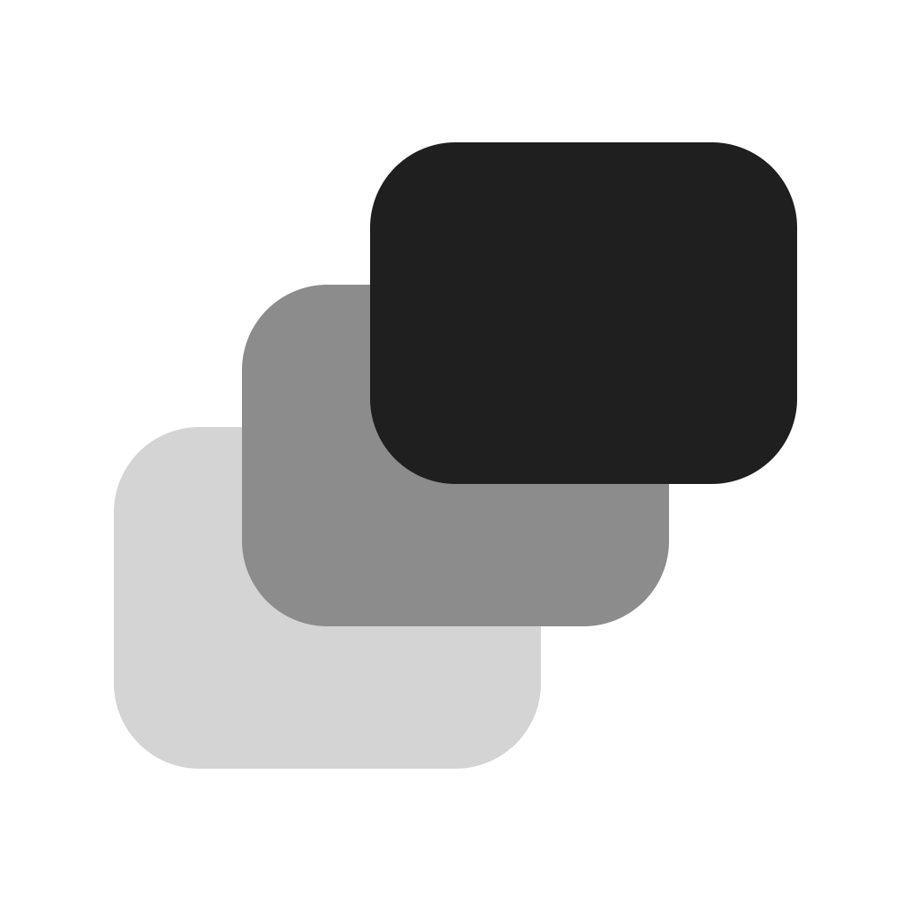
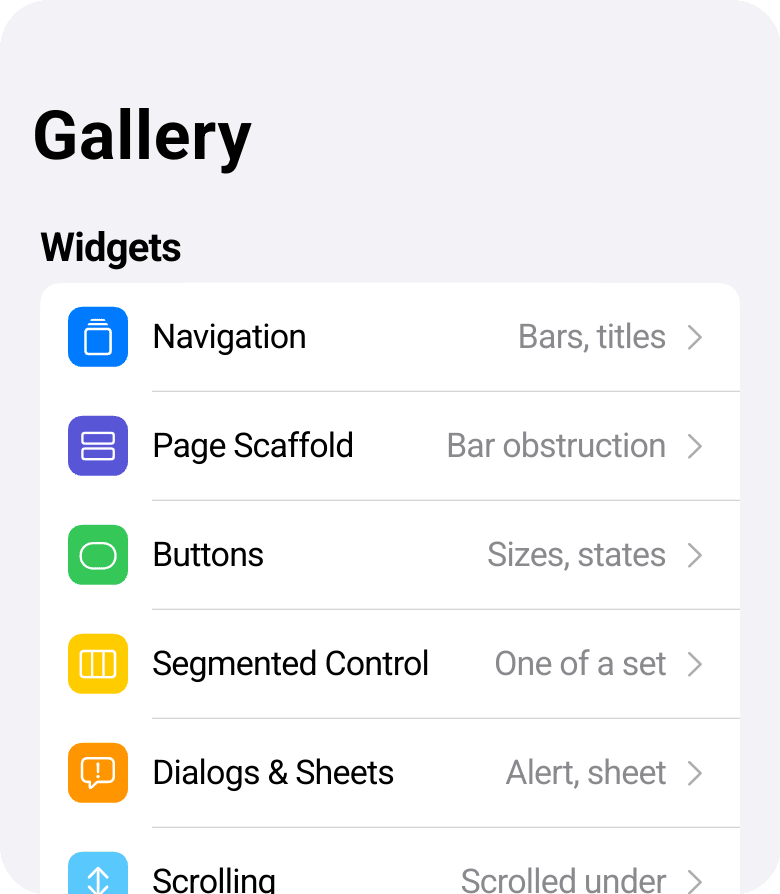
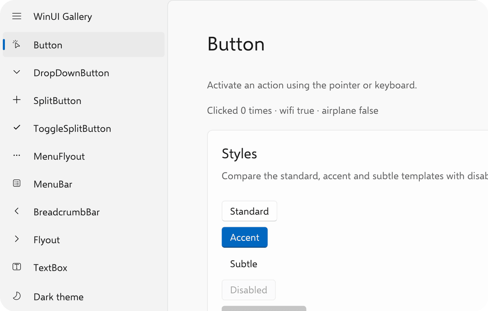

<p align="center">
  <picture>
    <source media="(prefers-color-scheme: dark)" srcset="assets/waft-logo-dark.png">
    
  </picture>
</p>

<h1 align="center">Waft</h1>

<p align="center">
  A UI framework for writing solid, fluent cross-platform apps.
</p>

Waft is a full-stack Rust framework. Everything from app logic down to the render engine, [valo](https://github.com/seedeai/valo), is written in Rust and works like a normal Rust package.

The framework layer is a port of [Flutter](https://github.com/flutter/flutter). Everything the framework needs from the platform sits behind a clear interface, which makes porting to a new platform easy.

The project is in alpha, while is ready to build apps on. Waft currently has two widget libraries ready to use:
- Cupertino: for mobile apps
- [WinUI](https://github.com/xtyxtyx/waft-ui/tree/main/crates/waft-winui): for desktop and web apps

## Apps built with Waft

<table>
  <tr>
    <td align="center" valign="bottom" width="33%">
      <a href="https://edged2.app">
        
      </a>
    </td>
    <td align="center" valign="bottom" width="33%">
      <a href="https://cupertino-gallery.inset.rs">
        
      </a>
    </td>
    <td align="center" valign="bottom" width="33%">
      <a href="https://winui-gallery.inset.rs">
        
      </a>
    </td>
  </tr>
  <tr>
    <td align="center" valign="top">
      <a href="https://edged2.app"><strong>Edged 2</strong></a>
    </td>
    <td align="center" valign="top">
      <a href="https://cupertino-gallery.inset.rs"><strong>Cupertino gallery</strong></a>
    </td>
    <td align="center" valign="top">
      <a href="https://winui-gallery.inset.rs"><strong>WinUI gallery</strong></a>
    </td>
  </tr>
  <tr>
    <td align="center" valign="top">
      A window switcher for macOS
    </td>
    <td align="center" valign="top">
      iOS-style widgets, from<br>
      <a href="https://github.com/xtyxtyx/waft-ui/tree/main/crates/waft-cupertino">waft-cupertino</a>
    </td>
    <td align="center" valign="top">
      Desktop and web widgets, from<br>
      <a href="https://github.com/xtyxtyx/waft-ui/tree/main/crates/waft-winui">waft-winui</a>
    </td>
  </tr>
</table>

## Start an app

`cargo waft` is a convenient CLI for scaffolding and running app with Waft:

```sh
cargo install waft-cli
cargo waft new myapp                  # --template winui for a desktop app
cd myapp
cargo waft run                        # this desktop
cargo waft run -d ios                 # an iOS simulator
cargo waft run -d android             # an Android emulator
cargo waft run -d web                 # a browser
cargo waft build dmg                  # and macos, ios, ipa, apk, msi, nsis, deb, appimage, web
```

> For more details, see [`waft-cli`](crates/waft-cli/README.md).

> Support of mobile platforms is experimental.

## Building an app with Waft

Waft keeps a clean interface between the framework and the platform (the embedder). The usual way to start an app is creating an embedder and providing a root widget to it:

```rust
use waft::{DefaultEmbedder, IntoWidget, Shell, run_app};
use waft_cupertino::CupertinoApp;

fn main() {
    DefaultEmbedder::default().run(|platform| {
        Shell::new(platform, |app| {
            run_app(app, CupertinoApp::new().home(Counter).into_widget());
        })
    });
}
```

Or you can also use the `#[waft::main]` macro to write the main function:

```rust
use waft::{App, IntoWidget, run_app};
use waft_cupertino::CupertinoApp;

#[waft::main]
fn main(app: &mut App) {
    run_app(app, CupertinoApp::new().home(Counter).into_widget());
}
```

### Writing the UI

The framework is a faithful port of Flutter with a large number of widgets available. Use them as you would in Flutter:

```rust
use waft::{App, BuildContext, Column, IntoWidget, StatelessWidget, Text, WidgetRef};

#[derive(Debug)]
struct Counter;

impl StatelessWidget for Counter {
    fn build(&self, _app: &mut App, _context: BuildContext) -> WidgetRef {
        Column::new()
            .children([
                Text::new("Counter").into_widget(),
                Text::new("0").into_widget(),
            ])
            .into_widget()
    }
}
```

### State management

Unlike Flutter, Waft has a built-in state management solution, inspired by [Zed's GPUI](https://zed.dev/blog/gpui-ownership).

App state lives in an `Entity`. Create one with `app.new_entity`, read it with `read`, and change it with `update`. A `read` inside a widget's `build` observes the entity: `notify` rebuilds that widget.


```rust
use waft::{App, BuildContext, Entity, IntoWidget, StatelessWidget, Text, WidgetRef};

let count = app.new_entity(|_cx| 0);

struct Label {
    count: Entity<i32>,
}

impl StatelessWidget for Label {
    fn build(&self, app: &mut App, _context: BuildContext) -> WidgetRef {
        let n = *app.read(&self.count);
        Text::new(format!("{n}")).into_widget()
    }
}

app.update(&count, |n, cx| {
    *n += 1;
    cx.notify();
});
```

### Structuring an app

The recommended architecture is three layers:

- **Logic**: the business logic, as plain Rust. It does not depend on `App` or `Entity`, so it runs and is tested on its own.
- **State**: the app's state as entities, built on the logic layer. This is where `App`, `Entity` and `Timer` are used. Entity events model what happens: an entity emits with `cx.emit`, another subscribes and reacts. A callback from outside the app reaches an entity through `AsyncApp::post`. This layer depends on `waft-foundation` alone, so it is tested with `AppCell` and no display.
- **UI**: widgets, kept thin. A widget reads entities in `build`, which subscribes it to them, and calls their methods from callbacks. It keeps only view state, such as whether a panel is open.

A new feature is one entity plus the widgets that show it.

## Contributing and AI

Waft is developed with strong assistance from AI agents, with humans leading the design, reviewing changes, testing, and remaining responsible for correctness.

AI-assisted contributions are welcome as long as the contributor fully reviews the work, understands how it fits the architecture, manually reviews code changes, and tests the work. Code that the contributor cannot explain, verify, or maintain should not be submitted.

How this repo is worked on: [AGENTS.md](AGENTS.md).

## License

MIT
